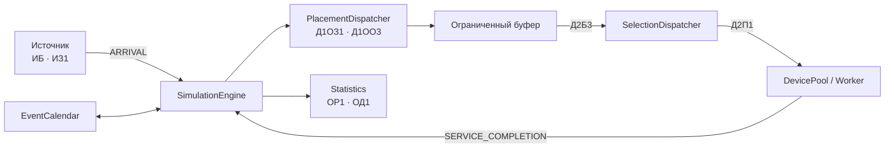

<div align="center">

# СМО обработки поисковых запросов интернет-магазина

**Первичные проектные артефакты · Вариант 3**

Шрамко Максим Кириллович · 5130904/40101


Модель системы, принимающей запросы поиска и фильтрации товаров, помещающей их в ограниченный буфер и распределяющей между вычислительными приборами.

</div>

---

## Навигация

- [О проекте](#о-проекте)
- [Архитектура модели](#архитектура-модели)
- [Ключевые диаграммы](#ключевые-диаграммы)
- [Расшифровка варианта](#расшифровка-варианта-3)
- [Правила моделирования](#правила-моделирования)
- [Структура репозитория](#структура-репозитория)
- [Как открыть диаграммы](#как-открыть-диаграммы)
- [Что предстоит реализовать](#что-предстоит-реализовать)

## О проекте

**Бизнес-домен:** серверная подсистема поиска и фильтрации товаров интернет-магазина. Источниками выступают веб-приложение, мобильное приложение и внешние интеграции. Заявка соответствует одному поисковому запросу пользователя.

Цель моделирования — подобрать конфигурацию с достаточной пропускной способностью, небольшой долей потерянных заявок и рациональной загрузкой вычислительных приборов.

> **Текущий этап:** проектирование до реализации программы. Численные выводы об оптимальной конфигурации и экономике следует делать только после серии воспроизводимых прогонов модели.

## Архитектура модели



**Основной путь заявки:** источник → событие генерации → диспетчер постановки → буфер → диспетчер выбора → свободный прибор → завершение обслуживания → обновление статистики.

## Ключевые диаграммы

Исходники диаграмм находятся в формате **PlantUML (`.puml`)**. Предпросмотры ниже позволяют быстро посмотреть схему прямо на странице репозитория.

### 1. Основной сиквенс

Показывает генерацию заявки, постановку в буфер, вытеснение при переполнении, триггер выбора, назначение на прибор и завершение обслуживания.

**Файлы:** [исходник `.puml`](docs/diagrams/sequence/main-flow.puml) · [PNG](docs/diagrams/rendered/main-flow-preview.png) · [SVG](docs/diagrams/rendered/main-flow-preview.svg)

<details>
<summary>Открыть предпросмотр основного сиквенса</summary>


</details>

### 2. Диаграмма классов

Фиксирует ответственность компонентов, приватные поля, методы и отношения между источниками, заявками, буфером, диспетчерами, приборами, календарём событий и статистикой.

**Файлы:** [исходник `.puml`](docs/diagrams/class/class-diagram.puml) · [PNG](docs/diagrams/rendered/class-diagram-preview.png) · [SVG](docs/diagrams/rendered/class-diagram-preview.svg)

<details>
<summary>Открыть предпросмотр диаграммы классов</summary>


</details>

### 3. Flowchart с дорожками

Отражает алгоритм в разрезе ответственности компонентов и основные развилки при генерации, переполнении буфера, выборе заявки и завершении обслуживания.

**Файлы:** [исходник `.puml`](docs/diagrams/flowchart/system-flow.puml) · [PNG](docs/diagrams/rendered/system-flow-preview.png) · [SVG](docs/diagrams/rendered/system-flow-preview.svg)

<details>
<summary>Открыть предпросмотр flowchart</summary>


</details>

### Дополнительные сиквенсы

| Сценарий | Исходник | Что показывает |
|---|---|---|
| Happy Flow | [`happy-flow.puml`](docs/diagrams/sequence/happy-flow.puml) | Буфер не заполнен, прибор свободен |
| Переполнение | [`overflow.puml`](docs/diagrams/sequence/overflow.puml) | Вытеснение старейшей ожидающей заявки |
| Операции буфера | [`buffer-operations.puml`](docs/diagrams/sequence/buffer-operations.puml) | Кольцевая постановка и выборка |
| Назначение прибора | [`device-assignment.puml`](docs/diagrams/sequence/device-assignment.puml) | Выбор первого свободного прибора либо ожидание |

## Расшифровка варианта 3

| Код | Правило модели | Где отражено |
|---|---|---|
| `ИБ` | Бесконечная совокупность потенциальных заявителей | `Source`, `SimulationEngine` |
| `ИЗ1` | Экспоненциальные интервалы между генерациями; пуассоновский поток | `Source`, `ExponentialDistribution` |
| `ПЗ2` | Равномерное распределение времени обслуживания `U(t_min, t_max)` | `Worker`, `UniformServiceDistribution` |
| `Д1ОЗ1` | Постановка с поиском свободной ячейки по кольцу от указателя постановки | `Buffer.enqueueCircular()` |
| `Д1ОО3` | При переполнении вытесняется самая старая заявка, ожидающая в буфере | `Buffer.evictOldest()` |
| `Д2П1` | Выбор первого свободного прибора по возрастанию номера | `DevicePool.findFirstFreeByIndex()` |
| `Д2Б3` | Кольцевая выборка первой занятой ячейки от указателя выбора | `Buffer.dequeueCircular()` |
| `ОР1` | Автоматическая итоговая таблица статистики | `ResultsReporter` |
| `ОД1` | Пошаговый вывод календаря событий и состояния СМО | `StepByStepView` |

## Правила моделирования

- **Диспетчер постановки** работает с заявкой, буфером и статистикой, но не выбирает прибор.
- **Диспетчер выбора** запускается по триггеру: после постановки заявки и после освобождения прибора. Он назначает заявку, только если одновременно есть ожидающая заявка и свободный прибор.
- **Приборы не отказывают.** Если все приборы заняты, заявки продолжают ожидать в буфере.
- **Переполнение относится к буферу.** При полном буфере `Д1ОО3` вытесняет самую старую ожидающую заявку; обслуживаемые заявки не затрагиваются.
- **Указатели постановки и выборки независимы** и должны отображаться в пошаговом режиме.
- **Пакетная обработка не включена:** модель использует кольцевую выборку `Д2Б3`, а не группировку заявок по источнику. Эту трактовку следует подтвердить по методическим материалам преподавателя до начала реализации.

Подробные решения и допущения: [описание предметной области и кодов](docs/variant-and-domain.md) · [правила модели и событий](docs/model-assumptions.md).

## Статистика и критерии экспериментов

Для каждого прогона следует фиксировать:

- количество сгенерированных, обработанных и вытесненных заявок;
- долю отказов `P_refusal = N_evicted / N_generated`;
- среднее ожидание в буфере `W_q` и среднее время заявки в системе `W`;
- загрузку каждого прибора и среднюю загрузку группы;
- пропускную способность и максимальную длину очереди.

Среди сравниваемых конфигураций ищется вариант с долей отказов не выше 10%, загрузкой приборов около 90% и минимальным средним временем в системе. Конкретные значения числа приборов, ёмкости буфера, интенсивностей потока и стоимости ресурсов должны быть подтверждены экспериментами и исходными данными, а не назначены произвольно.

## Структура репозитория

```text
.
├── README.md
└── docs/
    ├── variant-and-domain.md
    ├── model-assumptions.md
    ├── submission-checklist.md
    └── diagrams/
        ├── sequence/
        │   ├── main-flow.puml
        │   ├── happy-flow.puml
        │   ├── overflow.puml
        │   ├── buffer-operations.puml
        │   └── device-assignment.puml
        ├── class/
        │   └── class-diagram.puml
        ├── flowchart/
        │   └── system-flow.puml
        └── rendered/
            ├── *.png
            └── *.svg
```

## Как открыть диаграммы

1. Для быстрого просмотра используй PNG/SVG из `docs/diagrams/rendered/`.
2. Для правок открывай соответствующий `.puml` в IDE с поддержкой PlantUML или в совместимом рендерере.
3. При изменении алгоритма синхронно обновляй основной сиквенс, краевые сиквенсы, диаграмму классов и flowchart.

На GitHub исходники `.puml` хранятся как обычные файлы — поэтому рядом добавлены изображения-превью.

## Что предстоит реализовать

- Событийный календарь и воспроизводимый пошаговый режим.
- Табличный журнал событий и снимок состояния источников, буфера, указателей и приборов.
- Автоматические прогоны для нескольких комбинаций числа приборов и размера буфера.
- Сравнительную таблицу результатов и экономическое обоснование лучшей конфигурации.
- README с окончательными параметрами варианта после сверки с методичкой.

---

<sub>Учебный проект по моделированию системы массового обслуживания. Организация первичных артефактов ориентирована на пример репозитория [arcoirius/aps](https://github.com/arcoirius/aps); содержание адаптировано под поиск товаров интернет-магазина и заявленный вариант 3.</sub>
