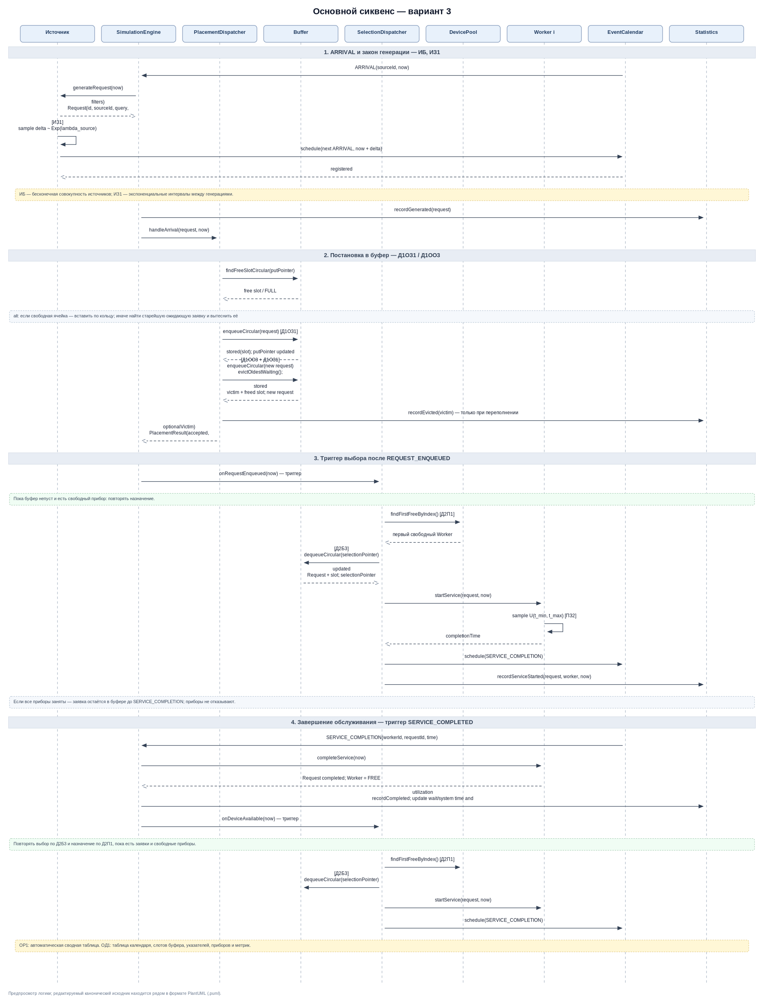
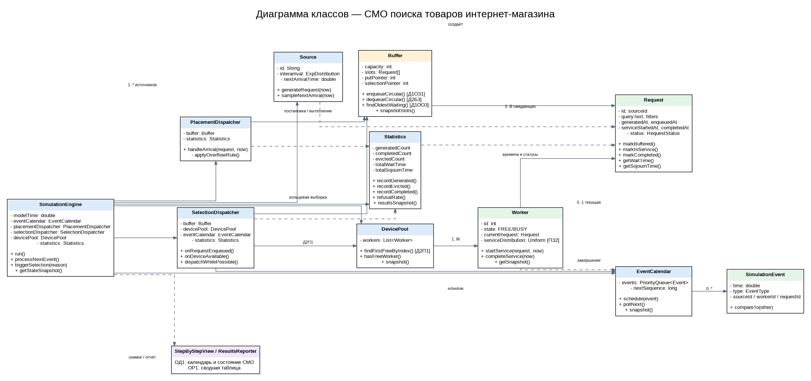
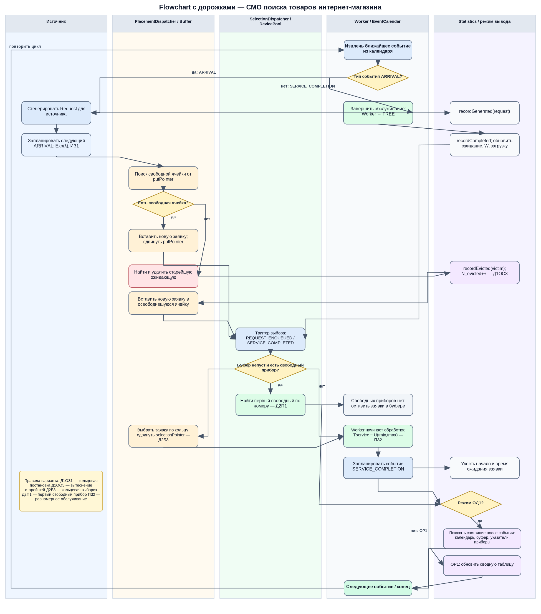

# Система обработки запросов поиска товаров интернет-магазина

**Автор:** Шрамко Максим Кириллович  
**Группа:** 5130904/40101
**Вариант:** 3  

Модель системы массового обслуживания, в которой поисковые запросы поступают от пользователей интернет-магазина, ожидают в ограниченном буфере и передаются свободным вычислительным приборам.

## Основные диаграммы

### 1. Основной сиквенс
Генерация заявки, постановка в буфер, вытеснение при переполнении, выбор заявки и её обслуживание.

[Исходник PlantUML](docs/diagrams/sequence/main-flow.puml) · [Открыть диаграмму](docs/diagrams/rendered/main-flow-preview.png)

Показать диаграмму

### 2. Диаграмма классов
Классы системы, их методы, поля и связи между компонентами.

[Исходник PlantUML](docs/diagrams/class/class-diagram.puml) · [Открыть диаграмму](docs/diagrams/rendered/class-diagram-preview.png)

Показать диаграмму

### 3. Flowchart с дорожками
Основной алгоритм работы системы и альтернативные сценарии.

[Исходник PlantUML](docs/diagrams/flowchart/system-flow.puml) · [Открыть диаграмму](docs/diagrams/rendered/system-flow-preview.png)

Показать диаграмму

### Дополнительные сиквенсы
- [Happy Flow](docs/diagrams/sequence/happy-flow.puml) — буфер и прибор доступны.
- [Переполнение буфера](docs/diagrams/sequence/overflow.puml) — вытеснение самой старой ожидающей заявки.
- [Операции буфера](docs/diagrams/sequence/buffer-operations.puml) — кольцевая постановка и выборка.
- [Назначение прибора](docs/diagrams/sequence/device-assignment.puml) — поиск первого свободного прибора.

## Расшифровка варианта 3

| Код | Правило модели |
|---|---|
| `ИБ` | Бесконечный источник заявок |
| `ИЗ1` | Экспоненциальные интервалы между поступлениями |
| `ПЗ2` | Равномерное распределение времени обслуживания |
| `Д1ОЗ1` | Кольцевой поиск места для постановки в буфер |
| `Д1ОО3` | При переполнении вытесняется самая старая ожидающая заявка |
| `Д2П1` | Выбирается первый свободный прибор по номеру |
| `Д2Б3` | Кольцевая выборка заявки из буфера |
| `ОР1` | Итоговая таблица результатов моделирования |
| `ОД1` | Пошаговое отображение состояния системы и календаря событий |

## Основные правила

- Диспетчер постановки работает с буфером и не выбирает прибор.
- Диспетчер выбора активируется после поступления заявки и освобождения прибора.
- Приборы не отказывают: отказ возможен только в буфере при его переполнении.
- Указатели постановки и выборки независимы.
- Статистика включает число поступивших, обработанных и вытесненных заявок, время ожидания и пребывания в системе, а также загрузку приборов.

Цель экспериментов — подобрать число приборов и размер буфера, при которых доля отказов не превышает 10%, загрузка приборов близка к 90%, а среднее время пребывания заявки в системе минимально. Оптимальная конфигурация определяется по результатам моделирования.

## Дополнительные материалы

- [Описание бизнес-домена и варианта](docs/variant-and-domain.md)
- [Допущения и логика событий](docs/model-assumptions.md)
- [Чек-лист перед сдачей](docs/submission-checklist.md)
